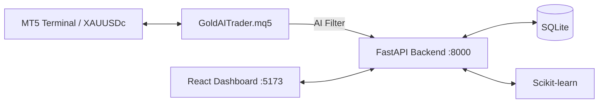

# GoldAITrader

Hybrid AI + Technical Analysis Automated Gold (`XAUUSDc`) Trading System for MetaTrader 5 (Exness Standard Cent), built with MQL5, Python FastAPI, SQLite, Scikit-learn, and React + TypeScript.

> [!WARNING]
> **Safety & Risk Disclaimer**: Default mode is **Monitoring Only** (`MODE_MONITORING`). Real-account automated execution is blocked in code. No trading strategy is guaranteed to be profitable; validate thoroughly on historical data and MT5 Demo accounts.

## Architecture



## Folder Structure
- `trading-engine/` — `GoldAITrader.mq5` and 11 `.mqh` modules (`Config`, `Logger`, `SafetyManager`, `MarketAnalysis`, `StrategyEngine`, `RiskManager`, `PositionManager`, `TradeManager`, `NewsFilter`, `SessionFilter`, `AIClient`, `Dashboard`)
- `ai-service/` — Modular FastAPI backend (`api/`, `connectors/`, `analysis/`, `strategies/`, `risk/`, `services/`, `training/`, `repositories/`, `tests/`)
- `backtesting/` — Conservative OHLCV backtesting engine (`engine.py`)
- `database/` — SQLite database & initialization/seed script (`init_db.py`)
- `dashboard/` — React + TypeScript + Vite + Tailwind + Lightweight Charts (10 pages)
- `scripts/` — Windows PowerShell automation scripts
- `docs/` — Architecture, API, Database, Strategy, Risk, AI, Backtesting, MT5, Cent Account, Testing, and Deployment docs

## Quick Start (Windows PowerShell)

1. **Setup** (creates/updates `.venv`, installs dashboard packages, initializes SQLite DB):
   ```powershell
   .\scripts\setup.ps1
   ```
2. **Start Backend & Dashboard (Mock Mode by default)**:
   ```powershell
   .\scripts\start-dev.ps1
   ```
   - Backend API & Swagger: `http://127.0.0.1:8000/docs`
   - Dashboard UI: `http://localhost:5173`
3. **Run Tests & Build**:
   ```powershell
   .\scripts\run-tests.ps1
   ```
4. **Connect Exness MT5 & Deploy EA**:
   See [docs/MT5_SETUP.md](docs/MT5_SETUP.md) and [docs/DEPLOYMENT.md](docs/DEPLOYMENT.md).

## Known Limitations
- **MQL5 Compilation**: Requires MetaEditor on Windows with MT5 installed; compilation cannot be verified without MetaEditor.
- **OHLCV Backtesting**: Cannot model intra-bar tick paths; conservative SL-first ordering is applied.
- **AI Model**: No pre-trained model is fabricated; until you train a model on historical data, `/api/v1/ai/predict` returns `WAIT` (`model_available: false`).
