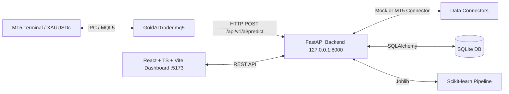

# GoldAITrader Architecture

## Components
- **Trading Engine (`trading-engine/`)**: MQL5 Expert Advisor (`GoldAITrader.mq5`) and modular `.mqh` files enforcing monitoring-by-default, real-account blocking, broker-aware `OrderCalcProfit` sizing, session/news filters, and AI confirmation.
- **Python Backend (`ai-service/`)**: FastAPI server supporting `MOCK` (default) and `MT5` modes, technical analysis, strategies, risk calculator, SQLite persistence, and Scikit-learn AI filtering.
- **Backtesting (`backtesting/`)**: Conservative OHLCV simulator with Cent (`USC`) / Standard (`USD`) accounting, spread, slippage, and commission.
- **Dashboard (`dashboard/`)**: Dark-themed React + TypeScript + Tailwind + Lightweight Charts terminal UI.
